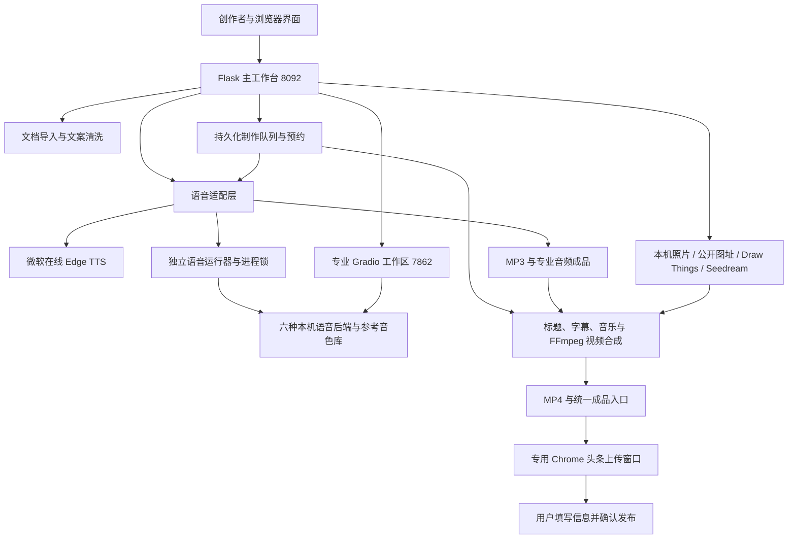

# 听文声影工作台产品规格说明书

**产品版本：1.2.3｜说明书修订：1.1｜更新日期：2026-10-15**

本说明书根据当前独立整合版源码编写，面向自媒体创作者、内容工作室、培训人员、开发维护人员及合作方。技术参数以当前代码的校验规则和各模型实际安装情况为准。

## 1. 产品定位：让自媒体人更快交付 MP4

听文声影工作台是一款面向自媒体人的本机声音与视频制作工作台。创作者准备文案，选择或录制自己的音色，配置照片、字幕与背景音乐，就能生成可试听的 MP3 和可发布的 MP4。短视频口播、长篇评书、书籍朗读使用同一套制作流程，长篇内容同样输出带配图和音乐的视频。

产品将听文视频工作台的图像、音视频合成和成品管理能力，与 IndexTTS 本机工作台的音色库、多模型、长文朗读和专业语音能力整合为独立应用。原应用继续保留各自入口与数据，本产品单独保存任务、音色、配置和成品。

核心价值是减少在多个工具之间搬运文案、声音和照片的操作，方便持续制作与快速启动发布。这里的“快速”指流程更短、材料可复用与操作集中；实际生成和上传时间取决于设备、模型、文案长度、字幕数量、素材和网络，不承诺固定生成速度或流量收益。

### 1.1 最适合的创作者

| 创作者 | 典型内容 | 使用价值 |
| --- | --- | --- |
| 热点、科技、行业观察自媒体 | 评论、新闻口播、政策或产品解说 | 文案清洗后直接选音色和照片，减少反复导出、搬运和手工找文件 |
| 读书、文学、评书创作者 | 名著串讲、章节朗读、长篇故事 | 章节选择、独立项目、配图和音乐共用流程；可预约夜间依次输出长视频 |
| 知识、历史、教育创作者 | 科普、历史故事、讲义、课程朗读 | 同一音色持续使用，标题与字幕样式可记住，适合系列化内容 |
| 产品讲解与品牌内容团队 | 产品介绍、使用教程、图文讲解 | 已有文案和照片可以直接制作声音与视频，保留 MP3 供其他渠道使用 |
| 小型内容工作室 | 多条待制作稿件、多个系列 | 提前配置并保存，每项保持自己的音色、参数和照片；串行制作减少逐项值守 |
| 有自己声音品牌的独立作者 | 个人观点、故事、知识分享 | 录音、试听、命名保存后反复选择自己的参考音色，无需每次重新录音 |

### 1.2 三个直接优势

**视频加工方便。** 作品的文案、音色、照片、字幕、音乐和 MP4 入口集中在同一产品。已有 MP3 可以换图继续合成；生成失败保留已完成材料，队列失败项可单独重试。成品有播放、下载、完整路径和 Finder 定位入口。

**文案到视频便捷。** 输入稿件或导入书籍，清洗与选择章节，保存配图和参数后可以一键生成当前 MP4，也可先试听 MP3 再制作 MP4。长篇和短篇共用操作，不必为长视频切换到另一套制作产品。

**音色克隆容易上手。** 展开录音入口，录制清晰人声，停止、试听、填写名称并保存；之后从音色库选择即可。克隆使用参考音频条件推理，不要求用户在界面训练一个新的模型。专业区仍提供不同模型的参考原文、风格、多人轮流朗读和更完整参数。

## 2. 当前范围与运行形态

| 项目 | 当前规格 |
| --- | --- |
| 产品名称 | 听文声影工作台 |
| 当前产品版本 | 1.2.3 |
| 当前整合平台 | macOS 本机应用；本机克隆后端面向 Apple Silicon 环境 |
| 主服务 | Flask，本机 `127.0.0.1:8092` |
| 专业朗读服务 | 独立 Gradio，按需启动于 `127.0.0.1:7862` |
| 桌面入口 | 带图标的原生 Swift 启动器；启动本机服务并打开浏览器 |
| 原应用 | 原听文视频工作台和原 IndexTTS 保留，不替换它们的数据目录 |
| 核心音频输出 | 主区 MP3；专业区 WAV、MP3、FLAC |
| 核心视频输出 | 横屏 1920×1080 MP4，H.264 视频与 AAC 音轨 |
| 长视频目标 | 支持长篇朗读制作；2–5 小时属于产品目标场景，实际受资源与输入拆分影响 |
| 公共网站 | 产品介绍、规格、使用和技术资料；不在网页云端替用户运行本机大模型 |
| GitHub | 独立私有源代码仓库，源码与文档可版本管理，模型与个人数据不随代码上传 |

当前整合版的验证基线不等同于原 Android 产品。网站保留的旧 PC／Android 文档属于历史资料；其中的试用限额、客户端功能和版本号不能直接套用于本整合版。本文不宣称已完成整合版的 Windows 或 Android 原生发布。

## 3. 用户看得见的产品结构

主导航提供四个工作区：

| 工作区 | 主要作用 | 适合何时使用 |
| --- | --- | --- |
| 创作工作区 | 稿件、音色、配图、MP3、MP4、已有音频导入与预览 | 日常短视频、单篇长视频或配置待制作材料 |
| 专业朗读 · 完整功能 | 六种后端、模型专用参数、完整音色库、文档队列、多人朗读与播放 | 深入配置声音或处理专业长文朗读 |
| 成品文件 | 汇总主区 MP3／MP4 和登记的专业音频，播放、下载、定位与交接 | 寻找生成文件、复用专业语音或启动头条分享 |
| 待制作队列 · 夜间制作 | 保存的独立项目、排序、预约、串行合成、暂停继续、失败重试 | 提前配置多条内容，在后台依次输出成片 |

创作区按“稿件整理 → 音色与语音 → 画面素材 → 试听、预览与导出”组织。音色区默认显示当前音色、模型与表达摘要及试听；模型和音色搜索列表、语音参数、录音上传分别折叠，需要时展开。标题、字幕和音乐细调也可展开查看。

顶部标题、导航和创作模式区域采用紧凑布局。“生成 MP3 与画面素材”“保存待制作项目”“一键生成当前稿件 MP4”随页面正常滚动，切换到其他工作区时隐藏。

## 4. 系统总体架构

### 4.1 模块与职责

| 模块 | 主要源码 | 技术职责 |
| --- | --- | --- |
| 主服务与任务 | `app.py` | 接口、本机会话、防并发、任务 JSON、后台线程、进度、暂停取消、素材确认、媒体验证 |
| 界面组织 | `templates/index.html`、`static/integration.js` | 主表单、折叠区、工作区切换、成品交接、随页面滚动的生成操作区 |
| 参数保存 | `preferences.py`、`static/preferences.js` | 参数白名单、范围校验、浏览器缓存、本机原子写入、串行保存与恢复 |
| 专业区与导入交接 | `integration.py` | 导入文档、启动和检查专业区、专业成品登记与读取、发布入口 |
| 语音桥接 | `omnivoice_local.py`、`scripts/omnivoice_runner.py` | 检查音色与模型配置、独立进程协议、调用原语音 API、生成与导入结果回传 |
| 专业语音服务 | `tts/mlx_indextts/webui.py` 及 `generate_*` | 模型加载、参考人声、参数档案、长文分批、多人朗读、音色与输出管理 |
| 在线语音 | `speech.py`、`edge_compat.py` | 长文分段、Edge TTS 接口兼容、片段保留、词时间事件、错误和重试处理 |
| 文档解析 | `tts/mlx_indextts/document_import.py`、`narration_text.py` | 格式识别、章节、缓存、PDF OCR、清洗、朗读单元与音色分配 |
| 图片 | `photo_import.py`、`drawthings.py`、`seedream.py` | 图片导入规范化、本机接口验证、云端单次生图及请求结果不确定处理 |
| 标题与字幕 | `scripts/make_homepage_bg.py`、`subtitles.py` | 高清画面、标题排版、字幕时间线、透明字幕图片与样式预览 |
| 音乐与视频 | `background_music.py`、`scripts/compose_video.py` | 音乐库、循环与响度处理、画面序列、FFmpeg 编码及硬件／软件回退 |
| 队列 | `production_queue.py`、`static/production-queue.js` | 项目快照、配图副本、顺序运行、定时、复用 MP3、失败后继续与归档 |
| 录音 | `static/voice-recorder.js`、音色导入接口 | 麦克风权限、MediaRecorder、Blob 试听、上传、WebM 本机转换、命名保存 |
| 发布交接 | `toutiao_publish.py` | 单独 Chrome 档案、文件控件识别、选定 MP4 交接、登录／上传状态、不点击最终发布 |
| 版本与记录 | `records.py`、`CHANGELOG.md` | 产品版本、变更摘要、运行事件和日志导出 |
| 桌面 | `launcher/`、启动与构建命令 | Swift 启动器、应用图标、配置源码位置、本机健康检查与重复启动 |

### 4.2 进程关系和资源边界

Flask 负责协调，不把所有模型直接加载到 Web 请求线程。主区克隆请求写入运行器输入 JSON，启动独立 Python 进程调用专业语音实现；进度通过标准输出 JSON 协议回传，诊断进入本任务日志。专业区在独立端口运行，通过同一套语音实现调用模型。

主区与专业区的本产品语音生成使用进程间文件锁，避免同时加载大量模型竞争统一内存。模型后端切换时按实际代码释放和加载资源，生成结束释放本次模型资源。原应用仍有自己的运行入口；同一台机器的内存、CPU、GPU和磁盘容量仍会影响多个应用同时运行的表现。

主区任务按音频、图片、视频分别记录状态。夜间队列调用已有任务接口顺序执行，而不是另建一套合成算法。收费 AI 图片必须先完成并保存成材料，队列再使用这些图片，无需夜间逐项点确认。

## 5. 从文案到 MP4 的日常操作

### 5.1 制作一条短视频

1. 启动桌面应用，进入创作区，选择短视频模式。
2. 粘贴文案，或导入 TXT／MD／其他文档；按需要执行文案清洗，检查标题、数字、引号和专有名词。
3. 选择语音来源和音色。想用自己的声音时，展开录音上传区先建立音色。
4. 选择照片，粘贴公开图片直链，或配置 Draw Things／Seedream 生成配图。
5. 确定首页标题、字幕与音乐。首页标题和背景音乐首次默认关闭，启用后会记住上次选择。
6. 可以直接“一键生成当前稿件 MP4”，也可以先“生成 MP3 与画面素材”，试听并检查图片后再确认 MP4。
7. 在成品区播放、下载或定位文件；点击“发布到今日头条”启动选定视频的上传交接。

### 5.2 制作书籍和长篇视频

1. 切换长篇模式并导入书籍；查看解析出来的章节、正文和提示。
2. 使用“全部选中”“全部取消选中”或逐章勾选，调整章节顺序与是否包含章节标题。
3. 可以整合所选章节到当前稿件，也可以将每章分别保存到待制作队列。
4. 配置音色、照片、字幕和音乐。长篇视频使用相同画面和配乐能力，不会被限定为只出 MP3。
5. 将配好的材料保存为独立项目，进入队列调整顺序。
6. 选择立即顺序生成 MP4，或预约未来的北京时间开始。
7. 后台依次输出每项 MP3／MP4；失败项保留并继续下一项，可之后单独重试。
8. 使用成品入口核验声音、画面、字幕、结尾与时长，再进入平台发布。

主区单次本机朗读有 100000 有效字符保护；长文按约 2500 字批次组织，批次还受模型分段限制。超出单项限制的整本书应按章节或卷拆分。解析出的章节结构取决于原书格式，TXT／MD可能作为整篇章节展示，不能承诺任意文档都自动获得完美章节。

### 5.3 录制、上传和保存自己的音色

1. 选择“克隆语音 · 本机多模型”，展开“录音 / 上传自己的音色 · 命名并保存”。
2. 点击“开始录音”，在浏览器授权使用麦克风，清晰朗读约 10–30 秒。
3. 点击停止，试听声音；不满意可以重新录制或清除。录音最长 3 分钟，也可下载本次录音。
4. 也可点击“上传已有录音”，选择已有参考音频，进入相同试听流程。
5. 填写音色名称，可选填录音中实际说出的参考原文，点击“命名并保存音色”。
6. 成功后音色加入本产品音色库并自动选中；以后从库中选择，无需每次重复上传。

参考音频上限 20 MB。主区支持 WAV、MP3、M4A、FLAC、AIFF、OGG、WebM；专业原音色库还保留 AAC／AIF 等原支持格式。浏览器 WebM／Opus 录音先在本机转换为 WAV，再交给原音色保存流程。麦克风权限被拒绝、没有设备或设备占用时有明确提示，可改用文件上传。未点击保存的录音只存在本页内存中，刷新不会自动恢复。

### 5.4 已有音频直接制作 MP4

展开“使用已有音频制作 MP4”，导入 MP3、WAV、M4A、AAC、FLAC、OGG、AIFF、OPUS、WMA 等受支持音频及照片。程序在本机解码、验证并转换工作 MP3，不再调用语音模型。单个音频上限 500 MB，照片仍遵守单张与合计限制。

没有文案时不自动生成口播字幕；填入与音频对应的文案后可使用按时长估算的字幕。原音频保留，音乐、标题和画面沿用同一 MP4 流程。

## 6. 文案与书籍处理的技术规格

主区支持 TXT、MD、Markdown、DOC、DOCX、PDF、EPUB、MOBI，导入文件上限 40 MB。专业原解析器保留 500 MB 文件保护、约 1 GB 解压体积保护和最多 20000 个归档成员保护。ZIP 型书籍解析采用成员和路径检查，不能把损坏或非支持格式当作正常正文。

| 格式／处理 | 实现方式与依赖 |
| --- | --- |
| TXT／MD | 文本读取、编码与正文清洗，保留朗读内容；章节取决于文本结构 |
| DOCX | 从文档结构中提取正文并组织章节，保留可用于朗读的文字 |
| DOC | 依赖本机文本转换能力，如 macOS `textutil`；工具不可用时返回提示 |
| PDF | 使用 PyMuPDF 提取文本；扫描或文本不足页面走本机 OCR |
| PDF OCR | 页面以 2.5 倍矩阵渲染，Tesseract 使用 `chi_sim+eng` 与 PSM 6；单页超时保护 180 秒 |
| EPUB | 解析归档、阅读顺序和 HTML 正文，清理非朗读标签 |
| MOBI | 使用可用的 Calibre 转换或 MOBI 解析依赖；依赖缺失时提示 |
| 主区文案清洗 | 去除 Markdown 样式、链接地址及括号外壳，保留正文、数字和正常标点，支持一次撤销 |
| 多人朗读单元 | 专业区按段落、逐行或句子分析；按用户音色顺序及每次切换单元数轮换 |

文档导入与清洗不是自动写稿服务。用户准备的内容、改写和事实核验由用户控制；没有在该流程中默认调用云端语言模型撰写整篇文章。PDF OCR与参考音频ASR是不同能力，分别服务于文字读取和声音参考原文。

## 7. 语音来源与六种本机后端

### 7.1 微软在线语音

通过 `edge-tts` 和本产品兼容层调用微软在线语音服务。保留普通话、方言、港台等预设入口和随产品保存的试听样音。试听样音可以本机播放，新合成需要网络，不要求用户填写个人 TTS Key。

长文自动分段，片段写入任务目录；已完成片段可供复用和检查。返回的词边界事件可用于字幕时间线。HTTP 403及其他错误会转换为可理解提示，接口失败不会自动改用另一音色或另一模型。

### 7.2 本机后端能力表

六个名称代表六种已接入后端，**不代表每台机器已完整安装六组权重，也不代表它们拥有相同的情绪或风格参数**。

| 后端 | 本机目录／实现 | 克隆与表达能力 | 调用要点 |
| --- | --- | --- | --- |
| OmniVoice | `models/OmniVoice-bfloat16`；`generate_omnivoice.py` | 主区默认克隆；专业区保留克隆、自动／设计等原模式；支持语言和风格指令 | 扩散步数、引导强度、温度、目标时长、参考时长等；必要时用参考原文ASR |
| VoiceStudio · OmniVoice 原生 | `generate_voicestudio.py`、`voicestudio_worker.py`，使用配置的 VoiceStudio 源码与环境 | 沿用 OmniVoice 相关模式和参考音色能力 | 独立原生运行进程与协议；源码位置可用 `VOICESTUDIO_PROJECT_ROOT` 配置 |
| IndexTTS 2.5 | `models/mlx-IndexTTS-2.5-int8`；`generate_v25.py`，调用 `index_tts_2_5_mlx` | 克隆参考音色，表达跟随参考音频 | 使用对应 MLX 权重、说话人条件缓存和分段参数；不套用2.0情绪选择 |
| IndexTTS 2.0 | `models/mlx-IndexTTS-2`；`generate_v2.py` | 克隆及原生情绪控制 | MLX生成结合 PyTorch 预处理等组件；有情绪强度、采样、扩散、交叉淡化参数 |
| Fish Audio S2 Pro | `models/fish-audio-s2-pro-8bit`；`generate_fish_s2.py` | 专业区保留克隆和自动／多说话人模式及自己的风格指令 | 独立温度、top-p、top-k、最大token、chunk长度、参考原文与参考时长 |
| CosyVoice 3 | `models/Fun-CosyVoice3-0.5B-2512`；`generate_cosyvoice3.py`，原运行库位于 `vendor` | 参考音色与原文驱动的声音合成 | FP16／FP32、NFE步数、参考时长；启动前校验配置与必要权重文件 |

模型由本机配置路径加载。专业服务明确设置 `HF_HUB_OFFLINE=1` 和 `TRANSFORMERS_OFFLINE=1`；缺少权重或依赖时返回错误，不在用户不知情时下载模型或切换云服务。CosyVoice 3还检查若干必要文件的存在及对应尺寸。

### 7.3 参考原文识别与表达预设

`models/Qwen3-ASR-0.6B-8bit`用于相关后端需要时的参考音频原文识别。用户也可直接填写与录音一致的参考原文；不同后端的原文按自己的字段保存，避免混用。

OmniVoice 的“平静、高兴、悲伤、激昂、严肃”由音高指令、语速和采样参数近似实现；“耳语”使用原生风格指令。它们不等同于 IndexTTS 2.0 的原生情绪向量。IndexTTS 2.5只跟随参考音频，Fish及CosyVoice使用自己的风格与参数。

参考ASR并不意味着本产品已对最终朗读做逐字强制对齐。主区本机克隆和导入音频的字幕仍按完整时长估算，见字幕章节。

## 8. 音色库如何保存与复用

音色文件存储于本产品独立 `tts/outputs/webui/voices/library/<voice_id>/`。以源文件 SHA-256 的前16位作为内容地址；重复上传同一参考文件优先选择已有条目，不重复复制。新条目保存用户名称、原文件名、源文件名、添加时间、时长、使用次数、收藏状态等元数据。

参考试听／预处理使用22.05 kHz单声道人声：读取前30秒、修剪静音、检查至少约0.5秒有效内容，再保留最长15秒并加短淡入淡出。不同后端的推理参考最大时长仍由各自参数决定。原音色库还有IndexTTS 2.5条件缓存文件，用于后续参考复用。

主区提供查找、刷新、试听、录音／文件上传、命名和保存。专业区保留完整音色库、名称修改、常用收藏、使用统计、删除与可恢复音色垃圾箱；常用快捷区最多10个条目。删除或清除待录音预览不会自动删除已完成的 MP3／MP4。

克隆输出质量受录音清晰度、说话一致性、背景噪声、参考原文准确度与模型本身影响。选中的音色 ID 是当前任务依据，不能用旧的全局音色缓存代替。音色数量随用户保存和删除变化，GitHub源码不包含用户个人音色库。

## 9. 常用参数与高级参数

### 9.1 主区可保存的语音参数

| 字段 | 初始值 | 校验范围 | 用途 |
| --- | --- | --- | --- |
| `speed` | 1.0 | 0.5–2.0 | 朗读速度，按模型生成或后处理实现 |
| `interval_silence` | 250 ms | 0–2000 ms | 分段之间停顿 |
| `seed` | 42 | 0–2147483647 | 随机种子 |
| `max_text_tokens` | 120 | 30–300 | 模型分段长度保护 |
| `temperature` | 0.8 | 0.1–2.0 | IndexTTS相关采样温度 |
| `omnivoice_num_steps` | 32 | 4–100 | OmniVoice推理步数 |
| `omnivoice_guidance_scale` | 2.0 | 0–10 | OmniVoice引导强度 |

主区适配层还校验 `top_p`、`top_k`、`emotion_strength`等支持字段。界面只展示对当前模型有意义的部分，其余完整模型参数保留在专业区。不同模型参数档案独立保存；切换模型不应重写其他模型的档案。后文附录列出源码里的完整默认参数。

### 9.2 画面、字幕与音乐

| 设置 | 当前行为 |
| --- | --- |
| 首页显示标题 | 首次默认不勾选；启用后记住上次状态 |
| 标题正文 | 默认文案前30字符，可自行修改；只在第一张画面叠加 |
| 标题样式 | 支持字体、颜色、字号、副标题及样式预览；主标题字号校验48–320 |
| 字幕 | 默认启用；颜色、字体、字号和垂直位置可改，标准初始字号48、位置90% |
| 字幕字号 | 28／36／48／60／72等界面档位 |
| 字幕位置 | 主区保存6–94%的有效范围，提供位置快捷入口 |
| 背景音乐 | 首次默认不勾选；可试听内置曲目或导入本机音乐 |
| 音乐音量 | 初始15%，0–100% |
| 音乐循环 | 120／180／300秒，初始180秒 |
| 音乐上传 | 单文件最多40 MB，支持常见音频格式 |

所有参数修改后自动保存，并提供保存状态与“保存配置”。折叠只改变界面显示，不会重置参数或使它们失效。新任务采用当前设置；已有任务及已保存队列项目保留自己的配置，需要主动重试或重新合成才使用修改后的设置。

## 10. 图片来源与模型调用

### 10.1 本机照片和公开图片网址

本机照片每批最多50张，单张最多20 MB、合计最多40 MB。图片通过 Pillow及可用的HEIF支持处理方向、解码和格式统一，输出规范化图片并去除原元数据。用户可以多选、删除、筛选、排序或重新替换本批照片。

公开图片网址必须是图片本身的可访问直链。服务会检查目标和传输，拒绝本机、局域网、链路本地等地址，防止把图片下载功能当成内网探测。需登录或有防盗链的图片可以先下载再用本机照片导入。

### 10.2 Draw Things 本机生图

连接用户启用的 `http://127.0.0.1:<port>` API，初始端口7861，允许1024–65535。先读取 `/sdapi/v1/options`，验证模型、采样器、步数、引导强度等字段和 `.ckpt` 模型名称，再调用 `/sdapi/v1/txt2img`。

当前单张请求为768×512、随机种子、单批单图、关闭hires-fix，核心采样设置采用用户应用当前配置并记录快照。它不是绑定某一个固定扩散模型；真正调用的是用户在Draw Things下载并选中的模型。只连接本机、不使用系统代理、不允许该本机接口重定向到外网，不自动回退到云端。

### 10.3 Seedream 可选云端生图

当前代码调用火山方舟 `https://ark.cn-beijing.volces.com/api/v3/images/generations`，提供两个模型 ID：

- `doubao-seedream-5-0-pro-260628`
- `doubao-seedream-5-0-flash-260915`

请求携带用户自己的 Bearer Key，设置 `size=2K`、`response_format=b64_json`、PNG和水印开启，要求返回单张有效图片。程序验证解码、尺寸和数据量后保存为任务材料。模型是否开通、调用价格和额度由用户方舟账户决定，不能把界面入口当成已获得模型权限。

收费请求只提交一次。超时、服务异常或返回结果不确定时，不自动重发，以免重复计费；提示用户查看服务方用量后再决定是否重试。夜间队列使用已保存图片，不会临时等待密钥、收费同意或自动请求新的收费图片。

## 11. MP3 合成、暂停与长文

主区本机克隆首先产生专业运行器的音频结果，再通过本机FFmpeg验证和转换为工作MP3。克隆及已有音频导入的工作转码使用MP3编码、192 kb/s、44.1 kHz、双声道；在线语音的源片段与时间事件按服务返回和拼接逻辑处理。

专业区输出可以选择WAV、MP3或FLAC并自选目录。长文按批次、模型token段和暂停／取消检查点组织，已输出片段保留在任务或专业输出目录供检查。边生成边播放、多音色轮换、文档队列和生成诊断沿用原实现。

多人轮流朗读根据段落／逐行／句子单元与用户所选音色顺序分配，每次切换单元数保存为1–20。它是用户控制的顺序轮换，不宣称任意小说都能自动识别人物并完成导演级角色配音。

任务可暂停、继续、取消、重试；操作作用于实际工作线程和子进程控制。重启将活跃任务标记为中断，不自动发起新的收费模型请求。不同模型的重试不保证从每个已完成片段精确断点续接，已输出片段仍会保留。

## 12. MP4 画面与标题技术

每张照片制作一张1920×1080画面，采用完整照片居中和模糊背景补齐。画面标题仅在第一张照片对应的画面出现，后续照片不重复叠主标题。多图按顺序平均分配完整音频时长，当前不是可自由拖拽片段长度的多轨剪辑时间线。

标题排版由Pillow绘制，支持用户选择的字体、颜色、字号、换行与副标题；实时预览用于检查样式。修改后需要重新生成MP4才会写入成片，不能把预览改变当成旧视频已被编辑。

MP4是照片与音轨编码的结果，不是默认调用视频生成大模型。产品适合配音驱动的图文讲解、照片叙事、评书和书籍视频；目前没有实现摄像视频剪辑、运动镜头自动生成、复杂转场或可编辑的多轨工程。

## 13. 字幕时间线

主区字幕依据用户文案生成。微软在线语音有可用词边界事件时优先构造语音时间线；本机克隆和已有音频导入使用完整音频时长与文案分段进行估算。专业参考原文ASR不会自动把这一能力变成最终音轨的逐字强制对齐。

时间线写入任务 `subtitles.json`，样式包含启用、字体、颜色、字号和位置。字幕预渲染为透明PNG，再组织字幕图序列与底图序列，由FFmpeg合成。关闭字幕仍可制作完整视频。

当前自动帧率：单图无字幕通常1 fps；多图无字幕至少5 fps，短画面分段时可提高，最高25 fps；有字幕通常10 fps。静态照片无需用30或60 fps重复存储同一画面，这种策略有利于长视频制作，但字幕精度仍受时间线和帧率影响。

## 14. 背景音乐处理

内置十一首曲目：原有三首轻柔钢琴／氛围 CC0 音乐，以及新闻播报 News Jingle、国际局势 Anticipation、军事专题 War Theme。News Jingle 为 CC BY 3.0，界面提供发布署名复制入口；原有五首为 CC0。另有用户提供的决胜时刻、钢铁之心、追猎行动、极速突进、谍影追踪，采用 CC BY 3.0／4.0，发布时需复制对应署名。曲库保留来源、授权与文件校验信息；用户可导入自己的本机音乐。内置和上传曲目可试听、选择和复用。

音乐先按用户选定的2／3／5分钟循环段处理：循环或截取、响度规范到约-18 LUFS目标、真峰值目标-3 dB、44.1 kHz双声道、每轮首尾约1.5秒淡入淡出。再按0–100%音量与朗读混合，使用以主朗读为时长基准的混音及限幅保护。

背景音乐写入MP4，MP3保留纯朗读。换音乐、调整音量或关闭音乐可以复用已有配音和图片重新合成，不需要为配乐变化再次调用语音模型。长视频的音乐循环覆盖完整音频时长。

## 15. 编码、成片验证与失败处理

当前输出H.264＋AAC、1920×1080、AAC 192 kb/s、44.1 kHz、双声道，使用 `+faststart` 方便常见播放器开始读取。macOS优先Apple VideoToolbox／AudioToolbox；硬件路线失败时按代码回退软件 `libx264`＋AAC。软件视频默认 `veryfast`、CRF 21。

编码使用独立FFmpeg子进程，通过 `-progress` 文件返回进度。暂停／继续／取消与进程控制联动。先写 `video.pending.mp4`，再用ffprobe核对视频流、音轨、1920×1080和音频／视频时长差不超过1.5秒等条件；验证通过才原子替换最终文件。

图片确认使用版本与内容摘要。图片在确认后被改动时需要重新确认，避免在用户不知情时编码不同材料。失败保留文案、图片、音频和诊断，不把未验证的临时文件当作最终可分享MP4。

## 16. 待制作队列与夜间合成

保存项目时冻结正文、名称、标题、音色、语音参数、专业模型档案、字幕、标题和音乐设置，并复制配图到项目目录。之后修改主区设置不改写已保存项目。书籍所选章节可以分别成为独立项目，一次保存1–200项。

| 操作 | 行为 |
| --- | --- |
| 保存待制作项目 | 只保存材料与配置，形成后续可执行项目 |
| 一键生成当前稿件MP4 | 保存并执行当前稿件，不自动执行其他待制作项目 |
| 按顺序生成MP4 | 对本轮选择的待制作项串行执行MP3、检查材料、自动确认保存的图片、MP4 |
| 先生成MP3 | 项目停在音频已完成阶段；之后继续MP4复用原音频 |
| 预约 | 保存未来的北京时间和输出模式，到时由后台调度器开始 |
| 失败 | 保留原因和素材，按用户选择继续下一项 |
| 暂停／继续／停止 | 联动当前项目任务；停止保留已生成材料 |
| 排序／换图 | 在队列非运行时调整，保存项目自己的图片版本 |
| 移出队列 | 归档移出，不物理删除项目文件 |
| 已完成项目 | 不自动重复生成，可以通过明确的单项操作处理 |

服务轮询预约和状态，运行时阻止另开同工作台制作任务，避免资源竞争。预约与制作期间使用macOS `caffeinate` 防自动休眠。浏览器可以关闭，但电脑和本机服务需要保持运行；不能承诺关机或合盖后自动开机。重启保留预约和材料，活跃中断项目需手动继续。

项目快照使用本产品的配置，不会修改原产品。音色库中被删除的参考、被移走的音乐等仍可能使后续执行失败，错误会保留供用户处理。

## 17. 文件入口与命名

默认MP3、MP4文件名取文案前30个字符，归一化连续空白，非法文件名字符替换为下划线；不足30字符使用全文。画面标题可以另改或关闭，文件名仍按文案开头生成。每项任务在自己的UUID目录中保存，专业同名输出追加序号避免覆盖。

当前结果区分别有音频和视频下载／定位入口。统一成品区提供播放、下载、完整本机路径、Finder定位；专业自选输出目录的音频通过 `products.jsonl` 登记，同样可找到并送回主区制作视频。

分享入口只接收已在本产品任务目录中、非空、非符号链接、不是 `video.pending.mp4` 的MP4，不接受任意拼接的外部路径。

## 18. 今日头条上传交接

点击某个MP4旁的“发布到今日头条”，主服务验证文件并创建发布请求。独立发布组件使用Playwright和Google Chrome，打开官方 `https://mp.toutiao.com/profile_v4/xigua/upload-video`。它使用本产品单独的Chrome档案，不读取或复制用户其他浏览器资料。

首次需在专用窗口登录，登录后继续查找视频上传控件。上传控件按官方页面与视频接受类型识别，排除封面图片控件；将用户点击的这个MP4交给网页。标题默认文案前30字，识别到空标题输入框时填入，不覆盖用户已输入内容。标签、声明、简介及最终发布由用户在平台操作。

| 发布状态 | 含义 |
| --- | --- |
| `starting` | 正在启动专用发布窗口 |
| `waiting_login` | 等待用户登录，登录后继续载入 |
| `waiting_input` | 等待发布页面或上传控件 |
| `uploading` | 文件已交给网页上传控件，尚不能据此宣称平台上传成功 |
| `ready` | 网页明确显示上传完成，并有标题／简介等编辑区域 |
| `failed` | 控件、文件或页面上传出现明确问题 |
| `cancelled`／`interrupted` | 标签页关闭或连接中断，文件保留，可重新操作 |

重复点击正在交接的同一视频复用请求，避免重复上传。另一视频需等待当前交接完成或关闭其发布标签页。文件已改变时停止交接；平台不确定结果不盲目重复。提供标题复制、完整路径复制和Finder定位作为辅助。

实际平台流程受登录状态、账号权限、页面更新、文件体积／时长限制、网络和转码影响。代码不会点击最终发布按钮。本轮按用户选择完成了本机模拟上传页测试，真实账号上传及完整待发布界面尚待首次登录后验证；不能把模拟测试当作头条发布成功。

## 19. 配置、数据和项目隔离

| 路径 | 保存内容 |
| --- | --- |
| `settings/preferences.json` | 主区参数白名单及模型参数档案；同时保存在浏览器本产品缓存 |
| `jobs/<UUID>/job.json` | 任务的正文、配置、状态、材料版本与结果元数据 |
| `jobs/<UUID>/` | 照片、画面、MP3、MP4、字幕时间线、进度与诊断 |
| `queue/state.json` | 项目顺序、运行、暂停、预约、输出模式与当前项目 |
| `queue/projects/<UUID>/` | 项目配置及配图副本，作为保存时的制作快照 |
| `documents/` | 主区导入文档与相关缓存 |
| `tts/outputs/webui/user_settings.json` | 专业区参数、各模型档案、输出和工作区偏好 |
| `tts/outputs/webui/voices/` | 独立音色库、参考试听、条件缓存和垃圾箱 |
| `tts/outputs/webui/products.jsonl` | 专业成品登记，包括自选输出目录 |
| `music_uploads/` | 用户导入的音乐 |
| `settings/toutiao-publish/` | 发布请求、专用Chrome登录档案与发布组件状态 |
| `records/` | 白名单运行事件与日志 |

主区保存采用白名单、数值范围校验和临时文件替换，前端串行提交，避免快速调整时旧请求覆盖新设置。表单正文、标题正文、待上传文件、图片网址、API Key、付费同意不作为下次默认操作保存；需要保存内容时使用任务或队列项目。

整合安装复制独立音色与可变数据。现有Python依赖、模型权重和部分运行库可以通过本机目录链接复用，不把用户任务和音色目录链接回原应用。移动或删除被复用的环境与模型会影响本产品启动，因此当前入口不是含全部模型的可迁移安装包。

## 20. 本机接口与访问保护

主服务只监听本机，限制Host为localhost或127.0.0.1。修改请求要求本机会话token并校验Origin／跨站请求信息；大多数POST要求JSON。已有音频导入例外使用multipart并设置自己的请求和表单大小保护。会话过期会提示恢复，不要求丢弃文案和照片。

任务目录使用UUID，成品访问检查路径、符号链接、临时文件与实际存在情况；图片下载检查公开网络目标，Draw Things只连接经过验证的本机API。云端生图Key不写入提交到GitHub的源码和任务默认配置，日志处理会隐藏相关凭据。

说明书末尾的接口目录从源码的GET／POST装饰器提取，覆盖主服务、整合与队列的46条路由声明。动态动作路由还包括confirm、pause、resume、cancel、retry-audio、retry-image等代码允许动作；它们不是开放的任意命令执行入口。专业Gradio使用其自己的前端／配置协议，由主区启动检查和成品交接。

## 21. 安装、部署与日常维护

### 21.1 当前已配置电脑

双击桌面应用，或者运行 `启动听文声影工作台.command`。启动器通过健康检查确认本产品，如果本机端口已由本产品占用则打开已有工作台；若被其他服务占用则提示，不强行停止其他程序。专业朗读通过导航按需启动。

头条发布组件安装命令为 `安装头条发布组件.command`，需要Google Chrome。组件使用独立 `.publish-venv`，不修改原TTS运行环境。桌面构建为 `构建桌面启动器.command`，需要Apple Command Line Tools，生成带图标的应用及本机ad-hoc签名。

### 21.2 从源码准备另一台电脑

1. 准备Apple Silicon Mac、Python 3.11+、FFmpeg／ffprobe、浏览器以及所需模型依赖。
2. 建立主区 `.venv` 并按 `requirements.txt` 安装Flask、Pillow、edge-tts、HEIF支持等。
3. 按原语音工程说明准备 `tts/.venv`、所选模型权重和必要 `vendor` 运行库，检查本机目录与模型许可。
4. VoiceStudio 后端另需配置对应源码位置；扫描PDF OCR另需Tesseract和中文／英文语言数据，MOBI可能需Calibre。
5. 如需头条自动载入，单独安装发布组件。
6. 启动主区，检查模型／音色、导入参考人声并试听；先制作短测试视频，再处理长篇和夜间队列。

源码仓库不附用户克隆音色、模型权重或现成完整Python环境。各后端内存需求不同，本文不虚构统一最低RAM或统一实时倍率；长篇制作前需预留音频、照片、字幕缓存和视频的磁盘空间。

### 21.3 参数与材料备份

需要恢复创作材料时，备份独立的settings、jobs、queue、documents、专业outputs和音乐上传目录。源码更新与作品备份是两件不同的事；GitHub上传忽略个人数据。搬迁后检查专业自选输出目录和模型链接是否仍有效。

## 22. 网络、费用和使用条件

本机克隆模型完整安装后，可以使用本机参考音色推理；本机照片、背景音乐处理和FFmpeg编码不产生按次云模型调用费。它们仍消耗设备资源，不能由此推导软件授权或一切服务永久免费的承诺。

微软新语音需要网络；公开图片下载、Seedream和头条上传需要网络。Seedream使用用户自己的Key并由服务方计费，发起前需要用户明确同意。Draw Things依赖已安装并选定的本机模型。头条依赖有效账号与视频发布权限。

软件授权、商业支持及合作报价通过现有公开合作联系方式沟通。当前网站不收款、不公布未经确认的固定价格，也不把旧Android的10000字／10图累计试用规则套用到本机整合版。模型和素材的使用条件应按用户采用的权重、音色及素材来源确定。

## 23. 已验证能力与实际边界

| 验证项目 | 当前证据 |
| --- | --- |
| 整合基础 | 原软件53个源码文件校验未变化；独立可变目录与桌面入口验证 |
| 实际短片 | 真实OmniVoice克隆MP3及三图、标题、字幕、15%音乐的约8.87秒MP4 |
| 五小时视频 | 使用测试音轨和循环音乐实际编码1920×1080，视频18000秒，音频18000.016秒，约488.6 MB，完整解码及末尾音乐核验 |
| 五小时验证范围 | 验证编码与配乐循环；不表示已完成整本书五小时TTS或五小时带字幕编码 |
| 夜间队列 | 真实预约后自动顺序完成两章克隆MP3及带字幕MP4，无逐项确认 |
| 分步合成 | 先MP3后MP4，音频文件和语音推理日志保持不变，证明该测试未重复合成语音 |
| 回归 | 136项回归通过；随后界面相关28项再次通过 |
| 录音 | 合成麦克风测试录音、停止、释放、试听、命名保存、上传已有录音及拒绝权限处理 |
| 音色存储 | 临时目录实际保存中文名称、重新读取及去重验证；WebM真实转WAV验证 |
| 头条 | Chrome模拟视频控件正确载入目标文件、排除封面、保留用户标题且不点击发布；真实账号待验证 |
| UI | 折叠参数重开恢复；生成操作区随页面滚动、页面末尾无覆盖及切换隐藏 |

当前不提供原始摄像视频多轨剪辑、复杂动画时间线、跨设备云同步、在营销网站云端托管用户大模型任务，或未经用户确认的最终平台发布。长视频能否顺利完整输出还取决于输入、权重、内存、磁盘、字幕规模及编码环境。

## 24. 常见操作问题

| 情况 | 优先处理 |
| --- | --- |
| 找不到MP3或MP4 | 使用顶部成品入口或当前结果的定位按钮；核对完整路径，不依赖手工猜目录 |
| 录音不能开始 | 检查浏览器与麦克风权限、设备占用；可改用已有录音上传 |
| 音色保存失败 | 检查名称、文件格式／大小与有效人声；等待正在进行的任务结束后再导入 |
| 某个模型不能加载 | 检查所选后端的完整权重、依赖及路径，六个入口不代表已全部安装 |
| PDF读不出正文 | 检查是否扫描PDF、是否有Tesseract及chi_sim／eng语言数据；查看OCR提示 |
| 长篇超出单项保护 | 按章节或卷拆分保存为独立项目 |
| 字幕对口型不精确 | 本机克隆／导入使用估算字幕，核对文案与音频是否一致；需要时调整或关闭 |
| 换图后不能合成 | 检查图片是否就绪及版本是否重新确认；已有配音可复用 |
| 夜间没有开始 | 检查北京时间、服务是否运行、电脑是否开机及是否有其他任务占用 |
| 队列一项失败 | 查看保留原因，修正该项素材／模型后单独重试；其他项按策略继续 |
| 头条还在等待登录 | 在专用Chrome窗口登录；不是在其他浏览器登录后就自动获得本窗口会话 |
| 文件已选中但还不能发布 | 等待平台上传／转码，核对账号权限与平台提示，再填写信息和确认 |

## 25. 维护与验收建议

修改声音调用后，检查选择的音色、模型、参数档案和输出时长是否一致；修改视频合成后，检查首帧、图序、全时长音轨、字幕、音乐尾段及媒体格式；修改队列后，检查项目冻结、顺序、失败继续和MP3复用。

可运行 `./.venv/bin/python -B scripts/run_tests.py`，回归使用隔离队列目录，不写入正在制作的用户队列。浏览器录音和发布控件测试为 `.publish-venv/bin/python -B scripts/test_publish_recording_browser.py`，使用模拟页面与测试声音；真实账号发布另行核验。

说明书更新应与源码基线同步。公众网站的事实JSON、首页、FAQ、架构、下载版和AI阅读文本应引用同一规格，不让旧版“没有字幕／背景音乐／队列”等说明混淆当前整合版。历史45章仍保留原正文并明确标注原PC／Android档案。

## 26. 文档、源码和公开入口

- 当前源码：独立私有GitHub仓库 `wangdexin1977/tingwen-shengying-workbench`，需要仓库权限才能查看源码。
- 本说明书：`docs/产品规格说明书.md`；网站提供相同内容的可阅读和下载版本。
- 接口与参数机器可读清单：`docs/接口与参数清单.json`，从当前源码提取，不包含用户配置或密钥。
- 版本变更：`CHANGELOG.md`；本机产品的“版本与日志”提供版本摘要。
- 公开网站：`https://tingwen-creator-studio-102.pages.dev/`。
- 现有公开合作微信：`wzqy2019`，添加备注“听文合作”。

以下附录为源码中的默认参数和路由声明，便于技术人员核对实现。默认值不等于用户当前设置，也不代表所有字段对所有模型都生效。

## 附录 A. 专业模型默认参数全表

### DEFAULT_SETTINGS

| 字段 | 源码初始值 | 作用与适用 |
| --- | --- | --- |
| `model_backend` | `"OmniVoice"` | 当前选择的模型后端 |
| `emotion` | `"跟随参考音频"` | 表达／情绪选择；按模型区分语义 |
| `emotion_strength` | `0.6` | IndexTTS 2.0情绪强度 |
| `speed` | `1.0` | 朗读语速倍率 |
| `seed` | `42` | 随机种子 |
| `interval_silence` | `250` | 批次／片段停顿毫秒 |
| `segment_overlap_ms` | `50` | IndexTTS分段交叉淡化重叠毫秒 |
| `max_text_tokens` | `120` | 文本分段token保护 |
| `temperature` | `0.8` | IndexTTS采样温度 |
| `diffusion_steps` | `25` | 声学扩散／解码迭代步数；2.0默认档案为16 |
| `max_mel_tokens` | `1500` | 声学token长度保护 |
| `top_p` | `0.8` | 采样累计概率阈值 |
| `top_k` | `30` | 采样候选数量 |
| `repetition_penalty` | `10.0` | 重复生成惩罚 |
| `cfg_rate` | `0.7` | IndexTTS条件引导相关参数 |
| `fast_vocoder` | `false` | 所选后端支持时使用快速声码器路线 |

### DEFAULT_OMNIVOICE_SETTINGS

| 字段 | 源码初始值 | 作用与适用 |
| --- | --- | --- |
| `omnivoice_mode` | `"clone"` | 克隆、自动或设计模式，由专业区选择 |
| `omnivoice_language` | `"chinese"` | 目标语言，主区桥接采用中文 |
| `omnivoice_ref_text` | `""` | 参考音频实际说出的原文 |
| `omnivoice_instruct` | `""` | 风格／设计指令 |
| `omnivoice_duration_s` | `0.0` | 目标时长；0表示不指定 |
| `omnivoice_num_steps` | `32` | OmniVoice推理迭代步数 |
| `omnivoice_guidance_scale` | `2.0` | OmniVoice条件引导强度 |
| `omnivoice_class_temperature` | `0.0` | 类别采样温度 |
| `omnivoice_position_temperature` | `5.0` | 位置采样温度 |
| `omnivoice_layer_penalty_factor` | `5.0` | 层采样惩罚系数 |
| `omnivoice_t_shift` | `0.1` | 采样时间步调节 |
| `omnivoice_ref_audio_max_duration_s` | `10.0` | 本后端推理参考音频最长秒数 |

### DEFAULT_FISH_S2_SETTINGS

| 字段 | 源码初始值 | 作用与适用 |
| --- | --- | --- |
| `fish_mode` | `"clone"` | 参考克隆或自动／多说话人模式 |
| `fish_ref_text` | `""` | Fish参考音频原文 |
| `fish_instruct` | `""` | Fish自己的风格指令 |
| `fish_temperature` | `0.7` | Fish采样温度 |
| `fish_top_p` | `0.7` | Fish累计采样概率 |
| `fish_top_k` | `30` | Fish采样候选数量 |
| `fish_max_tokens` | `1024` | Fish单次生成token保护 |
| `fish_chunk_length` | `300` | Fish分块长度 |
| `fish_ref_audio_max_duration_s` | `15.0` | Fish参考音频最长秒数 |

### DEFAULT_COSYVOICE3_SETTINGS

| 字段 | 源码初始值 | 作用与适用 |
| --- | --- | --- |
| `cosy_ref_text` | `""` | CosyVoice参考音频原文 |
| `cosy_precision` | `"fp16"` | FP16快速或FP32完整精度 |
| `cosy_nfe` | `10` | 数值解码迭代次数 |
| `cosy_ref_audio_max_duration_s` | `10.0` | CosyVoice参考音频最长秒数 |

IndexTTS 2.0 的模型默认档案将扩散步数设为16，其他基础档案采用通用默认值。专业区只展示和应用当前模型有意义的控制。

## 附录 B. 主服务接口声明全表

| 方法 | 路径 | 实现模块／函数 |
| --- | --- | --- |
| GET | `/` | `app.py` · `index` |
| GET | `/api/music` | `app.py` · `music_library` |
| GET | `/api/music/<track_id>/preview` | `app.py` · `music_preview` |
| POST | `/api/music` | `app.py` · `add_music` |
| GET | `/api/omnivoice` | `app.py` · `local_voice_capabilities` |
| GET | `/api/omnivoice/voices/<voice_id>/preview` | `app.py` · `local_voice_preview` |
| POST | `/api/omnivoice/voices` | `app.py` · `add_local_voice` |
| POST | `/api/title/preview` | `app.py` · `title_preview` |
| POST | `/api/subtitles/preview` | `app.py` · `subtitle_preview` |
| GET | `/api/session` | `app.py` · `local_session` |
| GET | `/api/health` | `app.py` · `health` |
| GET | `/api/records` | `app.py` · `record_list` |
| GET | `/api/records/export` | `app.py` · `record_export` |
| GET | `/api/jobs` | `app.py` · `jobs` |
| GET | `/api/videos` | `app.py` · `all_videos` |
| GET | `/api/videos/<job_id>/media` | `app.py` · `archive_video_media` |
| POST | `/api/videos/<job_id>/reveal` | `app.py` · `reveal_archived_video` |
| POST | `/api/videos/reveal-root` | `app.py` · `reveal_all_videos` |
| POST | `/api/drawthings/check` | `app.py` · `check_drawthings` |
| POST | `/api/jobs` | `app.py` · `create` |
| POST | `/api/jobs/import-audio` | `app.py` · `create_from_audio` |
| GET | `/api/jobs/<job_id>` | `app.py` · `status` |
| POST | `/api/jobs/<job_id>/use-image` | `app.py` · `use_image` |
| POST | `/api/jobs/<job_id>/select-images` | `app.py` · `select_images` |
| GET | `/api/jobs/<job_id>/images/<int:index>` | `app.py` · `gallery_image` |
| POST | `/api/jobs/<job_id>/<action>` | `app.py` · `action` |
| GET | `/api/jobs/<job_id>/media/<kind>` | `app.py` · `media` |
| GET | `/api/preview/<voice>` | `app.py` · `preview` |
| GET | `/api/preferences` | `integration.py` · `get_preferences` |
| POST | `/api/preferences` | `integration.py` · `save_preferences` |
| POST | `/api/documents/import` | `integration.py` · `import_document` |
| POST | `/api/expert/start` | `integration.py` · `start_expert` |
| GET | `/api/expert/outputs` | `integration.py` · `expert_outputs` |
| GET | `/api/expert/state` | `integration.py` · `expert_state` |
| GET | `/api/expert/audio/<key>` | `integration.py` · `expert_audio` |
| POST | `/api/expert/audio/<key>/reveal` | `integration.py` · `reveal_expert_audio` |
| GET | `/api/products/audio` | `integration.py` · `audio_products` |
| POST | `/api/videos/<job_id>/publish-toutiao` | `integration.py` · `prepare_toutiao_publish` |
| GET | `/api/toutiao-publish/<identifier>` | `integration.py` · `toutiao_publish_status` |
| GET | `/api/queue` | `production_queue.py` · `list_queue` |
| POST | `/api/queue/projects` | `production_queue.py` · `save_projects` |
| GET | `/api/queue/projects/<identifier>` | `production_queue.py` · `get_project` |
| POST | `/api/queue/projects/<identifier>/images` | `production_queue.py` · `replace_images` |
| POST | `/api/queue/start` | `production_queue.py` · `start_queue` |
| POST | `/api/queue/schedule` | `production_queue.py` · `schedule_queue` |
| POST | `/api/queue/<action>` | `production_queue.py` · `queue_action` |

接口路径中的UUID、文件名和音色ID均需通过本产品校验。修改请求要求本机会话，不是互联网开放API。
